# EuroHPC User Days 2026

The <a href="https://userdays2026.eurohpc-ju.europa.eu/" target="_blank">EuroHPC User Days 2026</a>
in Dublin (Ireland) was a nice opportunity to promote EESSI in the EuroHPC community,
and highlight our involvement in the <a href="https://my-eurohpc.eu/" target="_blank">EuroHPC Federation Platform</a>.

We also took the opportunity to organize another [EESSI hackathon](../../../../training-events/2026/hackathon-eurohpc-user-days.md)
in the wake of this event.

<figure markdown="span">
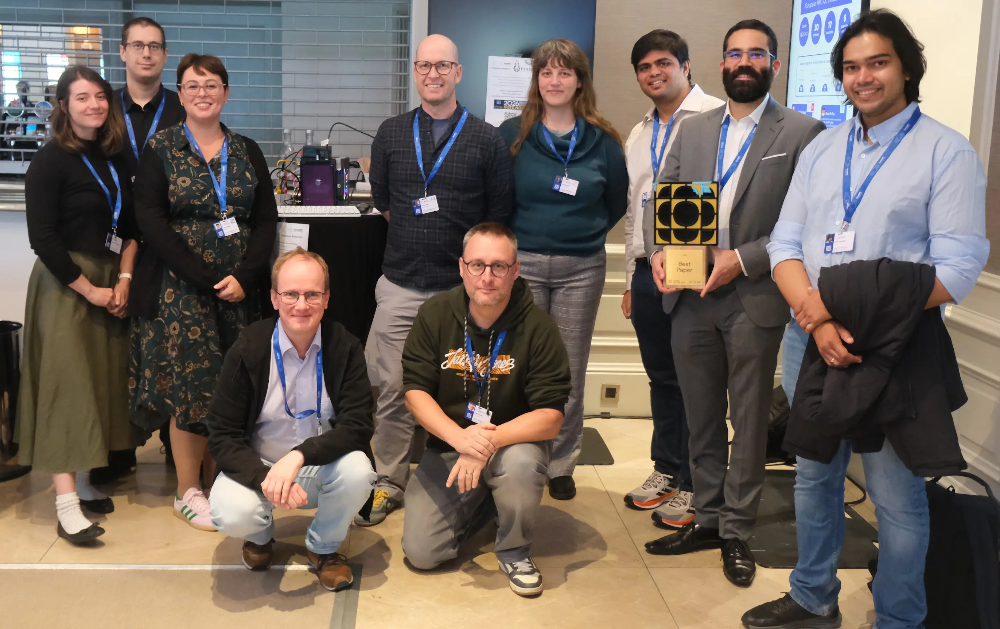{ width=80% }
<figcaption>Group picture with <a href="https://multixscale.eu" target="_blank">MultiXscale</a> partners</figcaption>
</figure>

<!-- more -->

## Networking sessions

## EuroHPC Federation Platform booth

<figure markdown="span">
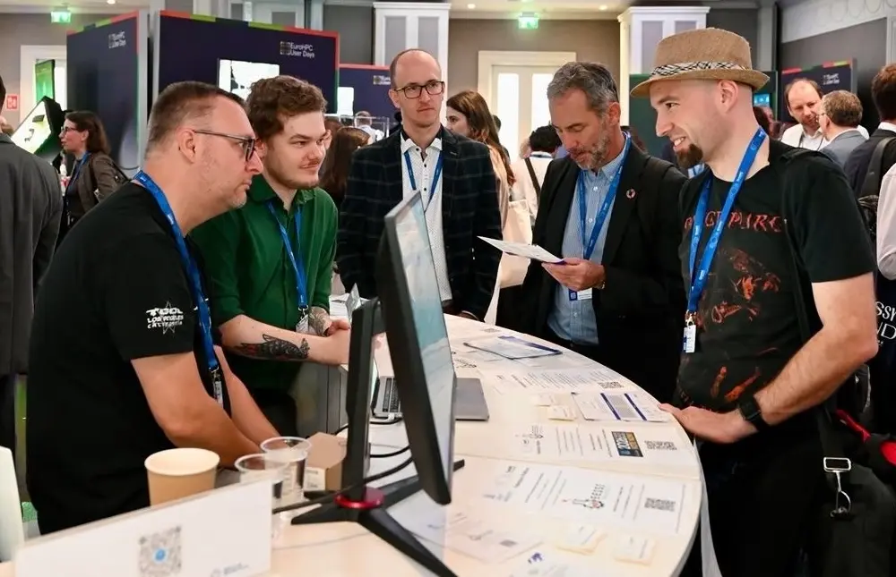{ width=80% }
</figure>

## MultiXscale poster

<figure markdown="span" style="display:flex; gap:0; justify-content:center;">
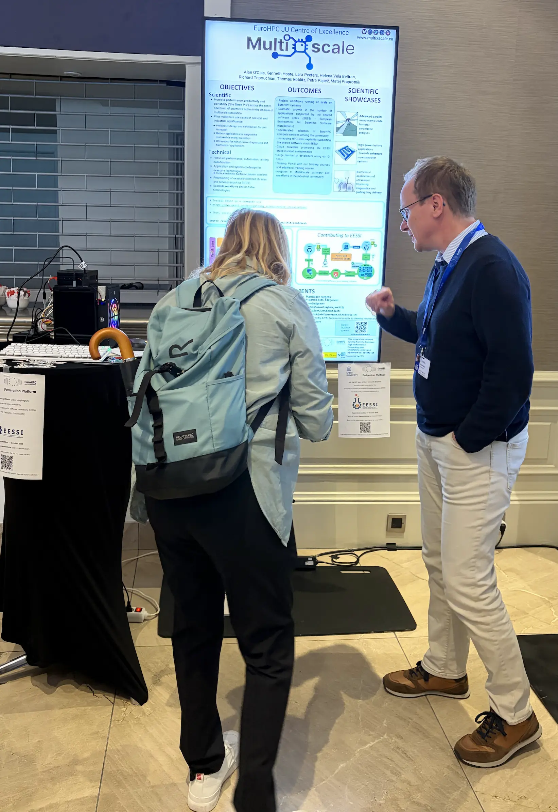{ width=40% }
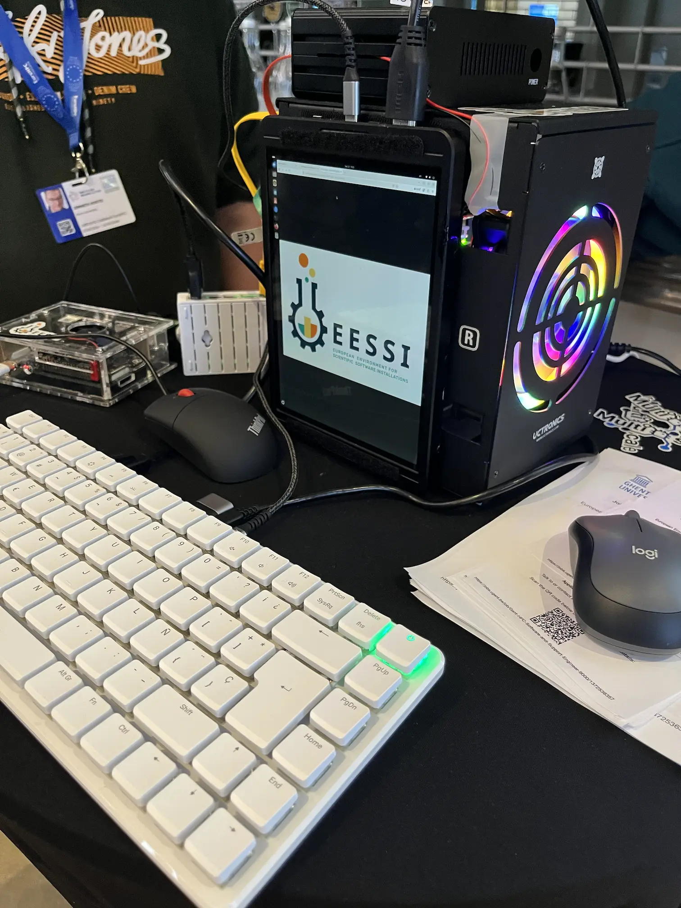{ width=40% }
</figure>

## Plenary sessions

### EuroHPC User Forum panel session

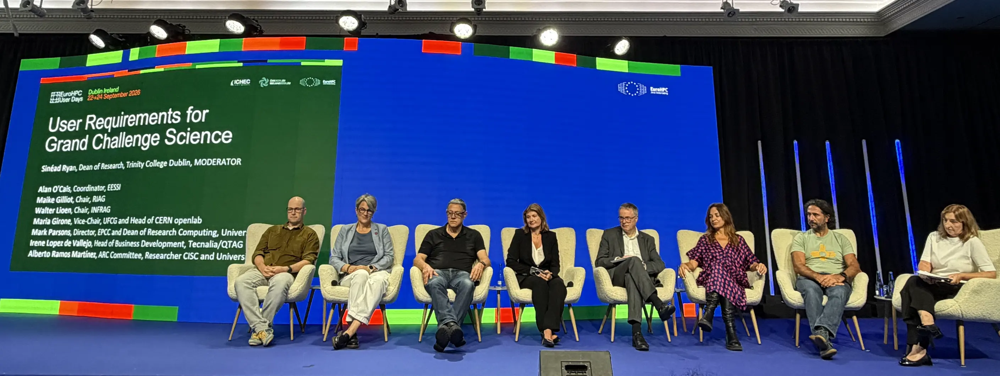{ width=100% }

### *Celebrating EuroHPC JU ExaStars* plenary session

<figure markdown="span" style="display:flex; gap:0; justify-content:center;">
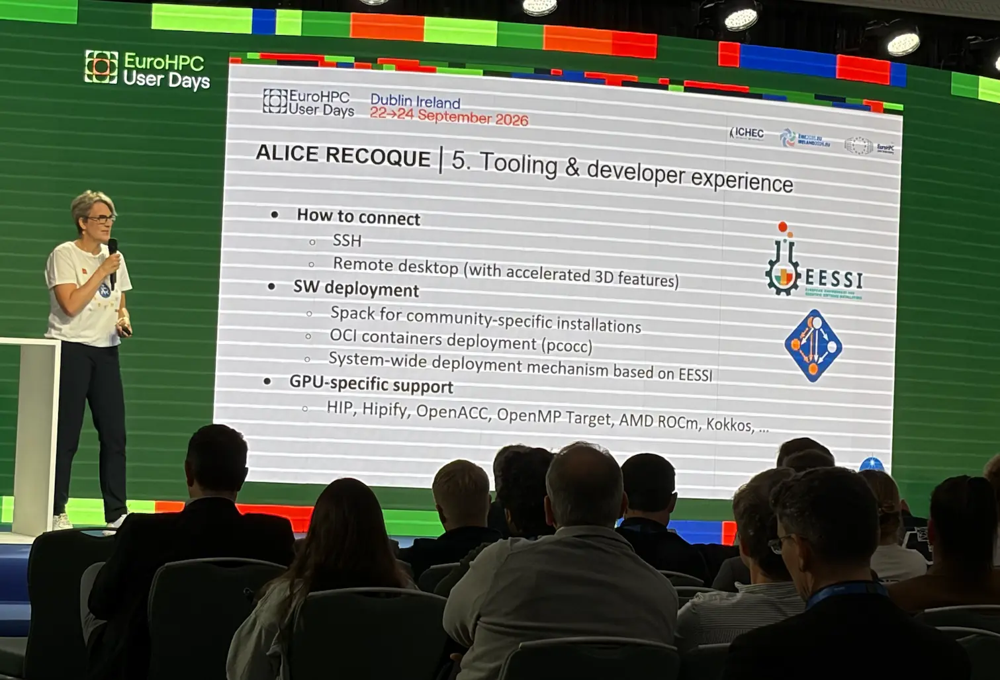{ width=50% }
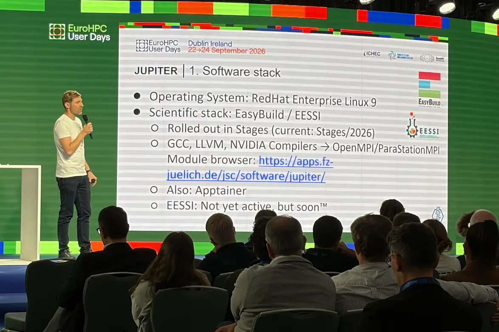{ width=50% }
</figure>

### Plenary talk on EuroHPC Federation Platform

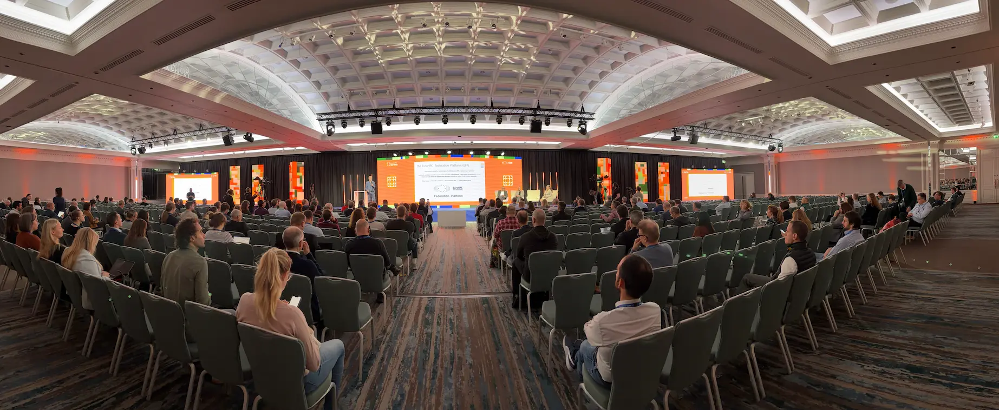{ width=100% }

## EESSI hackathon at Trinity College

<figure markdown="span" style="display:flex; gap:0; justify-content:center;">
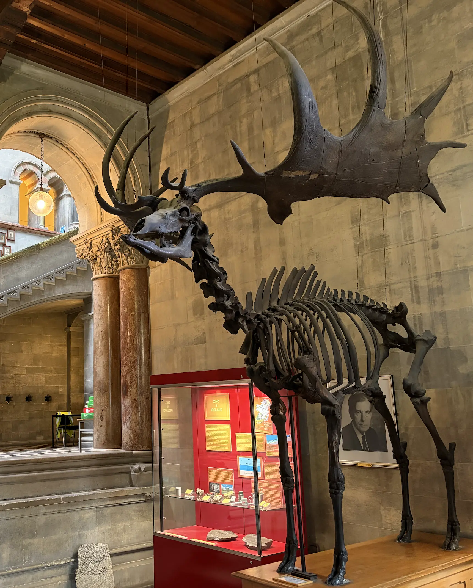{ width=40% }
{ width=40% }
</figure>

<figure markdown="span">
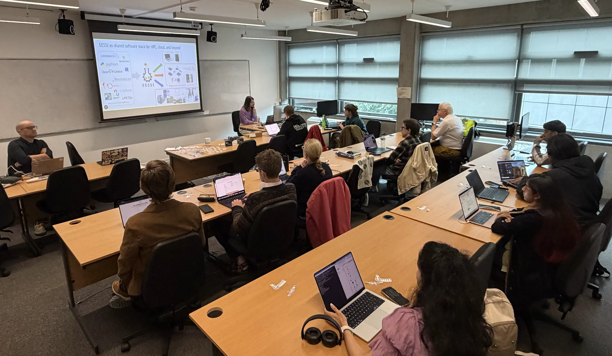{ width=80% }
</figure>

<figure markdown="span">
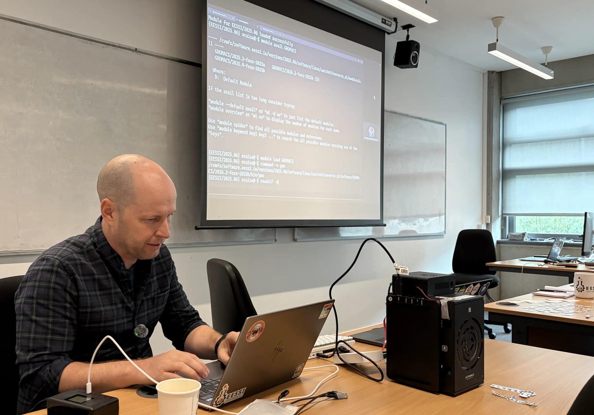{ width=80% }
</figure>

<figure markdown="span">
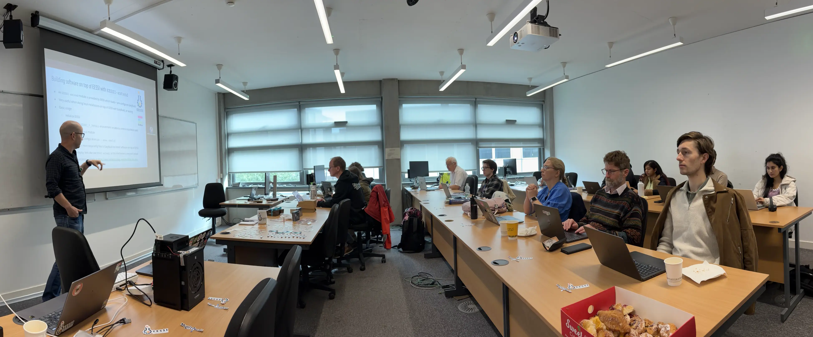{ width=80% }
</figure>

<figure markdown="span">
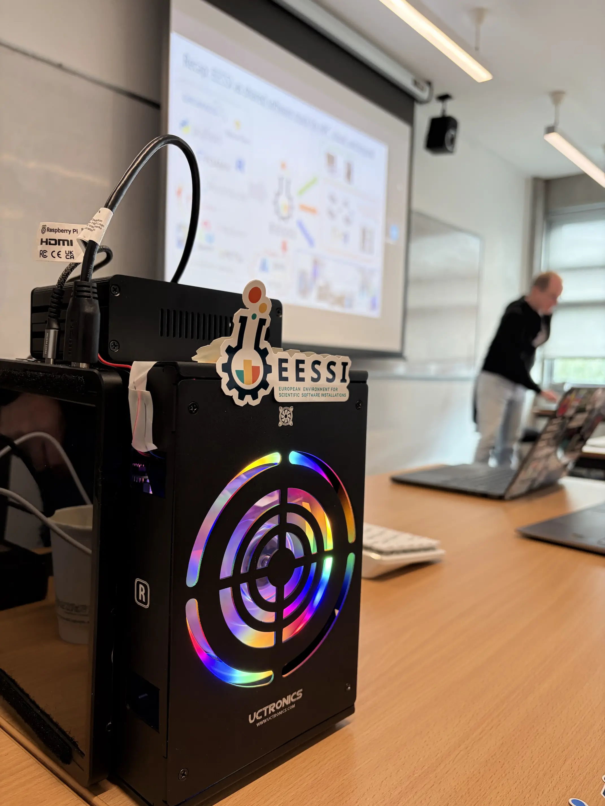{ width=50% }
</figure>

<figure markdown="span">
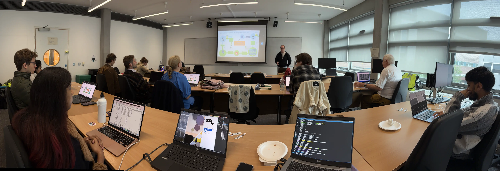{ width=80% }
</figure>

<figure markdown="span">
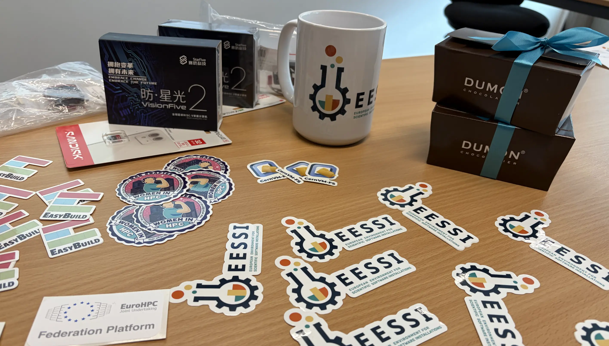{ width=50% }
</figure>
