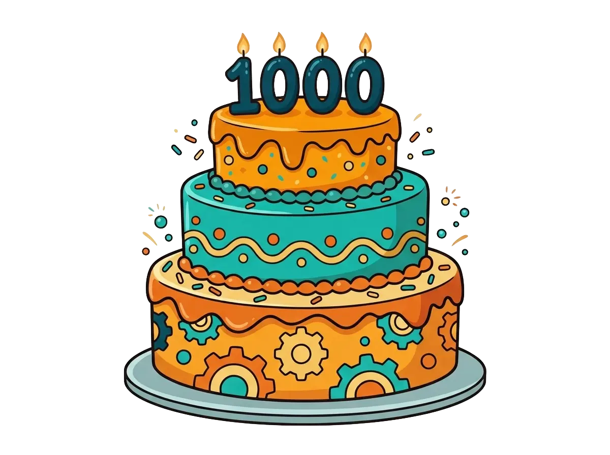

# Over 1,000 unique software projects available!

<figure markdown="span">
{width=50%}
</figure>

Since today, installations for **over 1,000 unique software projects** are provided by the
main EESSI CernVM-FS software repository [`software.eessi.io`](../../../../repositories/software.eessi.io.md). :partying_face:

<!-- more -->

For most of these software projects, multiple different versions and/or configurations are installed.
Note that this count does *not* include the over 3,500 extensions (Python packages, R libraries, etc.) that are also available.

In total, across all software projects, versions, configurations, and supported [CPU](../../../../software_layer/cpu_targets.md)
and [GPU](../../../../software_layer/gpu_targets.md) targets,
EESSI currently provides **over 52,000 software installations** (again, excluding extensions).
An overview of all software installations, *including* available extensions, provided by EESSI is
[available in our documentation](../../../../available_software/index.md).

See also our documentation on [how to access EESSI](../../../../getting_access/is_eessi_accessible.md),
[use EESSI](../../../../using_eessi/eessi_demos.md),
and [install software on top of EESSI](../../../../using_eessi/building_on_eessi.md).
In case of questions of problems, get in touch with the [EESSI support team](../../../../support.md).

