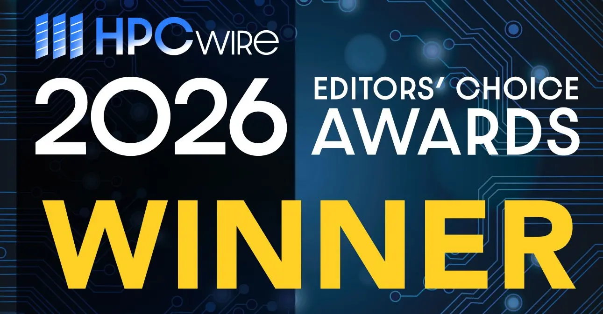
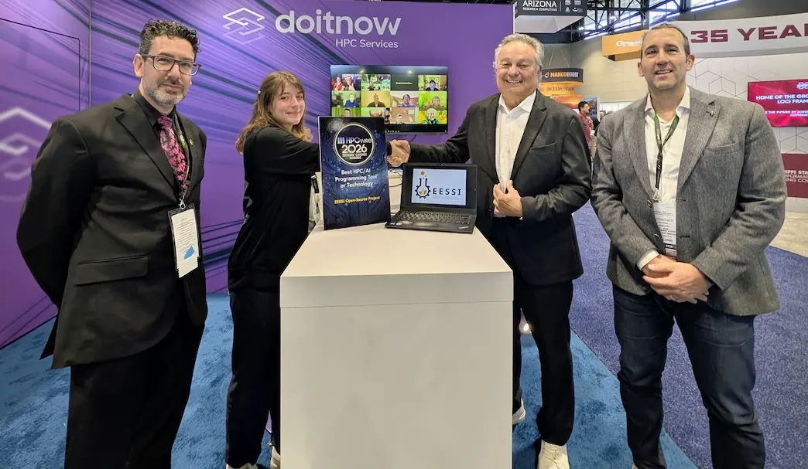
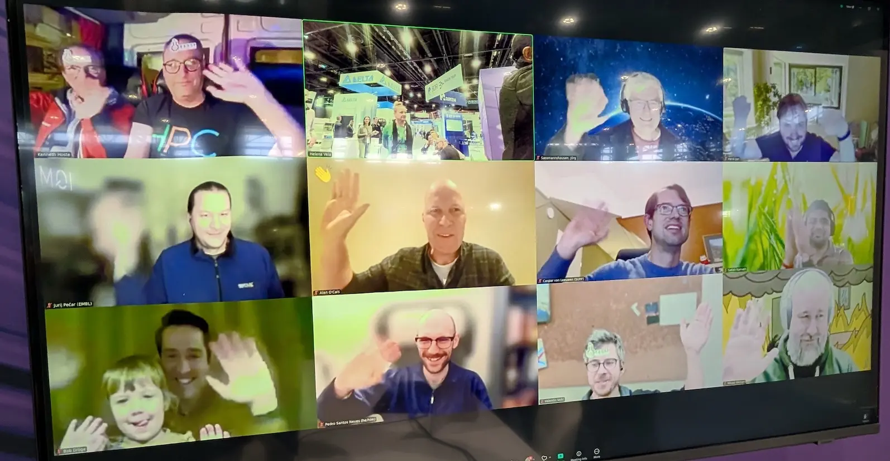

# EESSI has won an HPCwire award... again!

<figure markdown="span">
{width=50%}
</figure>

We are excited to share that **EESSI has won an *HPCwire Editors' Choice Award*** in the *Best HPC/AI Programming Tool or Technology* category,
as announced at the <a href="https://supercomputing.org" target="_blank">SC'26</a> conference in Chicago.

This is the *second time* that EESSI has won an HPCwire award, the first time being
the *HPCwire Readers' Choice Award* at SC'24 in Atlanta;
[see the blog post we wrote back then](../../2024/11/hpcwire_award_2024.md).

<!-- more -->

The award was handed over by Tom Tabor, CEO of TCI Media and Executive Publisher of <a href="https://hpcwire.com" target="_blank">HPCwire</a>,
to <a href="https://www.doitnowgroup.com/" target="_blank">Do IT Now</a> at their booth on the exhibit floor at the Supercomputing conference.
Do IT Now has been actively contributing to EESSI, and is a partner in the <a href="https://multixscale.eu" target="_blank">MultiXscale</a>
EuroHPC Center-of-Excellence, through which the development of EESSI has been funded in the last couple of years.

<figure markdown="span">
{width=80%}
</figure>

Only a handful of EESSI contributors were present in Chicago, so we scheduled a video conference call at the time of the award ceremony.
This allowed people to remotely attend the award handover, and celebrate the recognition of their extensive efforts.

<figure markdown="span">
{width=80%}
</figure>

Check out the short recording of this festive moment on the Supercomputing exhibit floor:

<iframe width="560" height="315" src="https://www.youtube.com/embed/-XpbuF9nSVU?si=K4HOZVP5tmcttZxt" title="YouTube video player" frameborder="0" allow="accelerometer; autoplay; clipboard-write; encrypted-media; gyroscope; picture-in-picture; web-share" referrerpolicy="strict-origin-when-cross-origin" allowfullscreen></iframe>

We feel this award is well deserved, see also [our earlier blog post](../09/vote-hpcwire-award-again.md) summarizing the progress we have made
since November 2024.

For the full list of HPCWire award winners, <a href="https://www.hpcwire.com/2026-hpcwire-awards-readers-editors-choice/" target="_blank">see HPCwire</a>.
